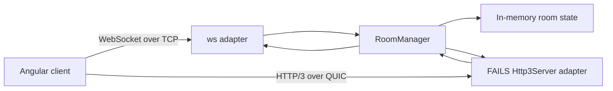

# Architecture

## Runtime shape

The Angular 20 standalone client lives in `src/`; the Node/Express service owns rooms, identities, validation, sequencing, and board snapshots. Both adapters use `shared/protocol.ts` and the same `RoomManager`.

## Event and room rules

Every application event has an event ID, room ID, server-checked user ID, event type, timestamp, room sequence number, and payload. The client proposes sequence number `0`; the server assigns the authoritative room sequence. The first transport message is a join handshake. The server generates a UUID identity and returns it in `BOARD_SNAPSHOT`; it never accepts the joining client’s claimed identity.

An invitation room ID is a bearer secret: only people who know it can join, but this demo does not include account authentication or authorization roles. Share generated room IDs only with intended participants. Rooms and their board snapshots remain in memory after the last disconnect so an automatic reconnect can resynchronize; restarting the server clears them.

The server validates event shape and size, room membership, event type ownership, board-object geometry, cursor sequence numbers, and per-peer event rates. WebSocket frames are limited to 64 KiB. WebTransport datagrams are limited to 1200 bytes by the adapter. Invalid and stale datagrams are discarded; committed operations always use a reliable path.

## Transport behavior

WebSocket mode uses one persistent `ws` connection. All messages, including cursor movement, share its reliable ordered stream. A reconnect uses exponential backoff, rejoins the same room, and receives a fresh board snapshot.

WebTransport mode uses `@fails-components/webtransport` `Http3Server` and its HTTP/3 QUIC backend. A client-created bidirectional stream carries four-byte, big-endian length-prefixed JSON frames. Drawing commits, object edits, clear, undo/redo, presence, snapshots, and ping/pong use this reliable stream. Cursor moves and live draw previews use compact JSON datagrams. The final `DRAW_END` event commits a completed stroke/shape reliably, so losing a preview cannot lose board state.

QUIC can avoid TCP-style cross-stream head-of-line blocking between independent streams. It does not remove congestion control, retransmission delay on reliable data, or every effect of packet loss. This demo uses one reliable board stream per session; it does not claim that QUIC is faster.

## Measurements

Connect time uses the client’s elapsed monotonic time from adapter creation to the transport-ready event. RTT is a client-measured PING/PONG round trip, not one-way latency. Message and byte counts are observed at the browser adapter. Server processing time is measured inside the server’s PING handler. Datagram drops count local application simulation drops, oversize messages, and failed datagram writes; it is not a measurement of network packet loss. Compare identical machines, browsers, room sizes, payload sizes, and workloads over repeated trials.

## Current boundaries

Room persistence is intentionally in-memory. There is no MySQL repository implementation, account system, production authorization, deployment TLS automation, or multi-process room coordination. The local demo uses a single Node process. Put a trusted HTTPS/HTTP/3 edge, authenticated room access, persistence, observability, and horizontal coordination in place before exposing it to untrusted networks.
